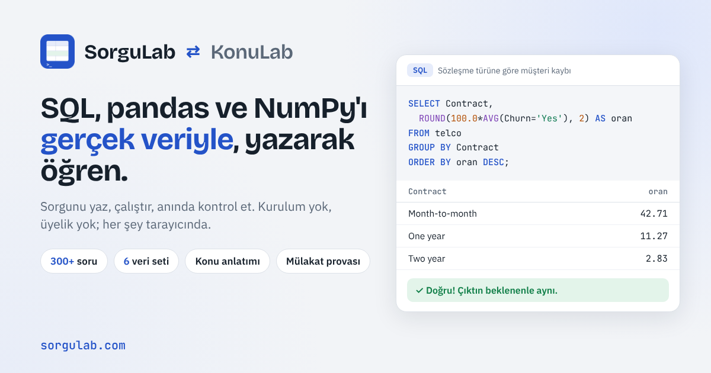

# SorguLab

**SQL, pandas ve NumPy'ı gerçek veri setleriyle, yazarak öğrenmek için bir alıştırma alanı.**
Kurulum yok, üyelik yok; her şey tarayıcıda çalışır.

👉 **[sorgulab.com](https://sorgulab.com)**

## Neler var?

- **Alıştırmalar:** 6 hazır veri setinde kolaydan zora 300'ü aşkın SQL ve Python sorusu. Kodunu yazıp çalıştırırsın, **Kontrol et** ile çıktın beklenen sonuçla karşılaştırılır. Takılınca ipucu, çözüm ve "Neden böyle?" açıklaması.
- **Tahmin Et:** Kodu çalıştırmadan çıktısını tahmin et. NULL, JOIN, window function, pandas ve NumPy'daki sık tuzaklar.
- **Mülakat provası:** Süreli kod mülakatı ya da teorik test.
- **Serbest Alan:** Veriyle istediğin gibi oyna; sonucu grafiğe çevir ya da Excel'e indir.
- **Kendi verin:** Excel ya da CSV dosyanı yükle, onunla çalış. Dosyan sadece senin cihazında kalır.
- **KonuLab:** SQL, Python temelleri, pandas ve NumPy konu anlatımları; her örnek gerçek çıktısıyla.
- **Yapay zekâ desteği (isteğe bağlı):** Kendi ücretsiz Gemini anahtarınla hatanı açıklatabilir, kendi verine özel soru ürettirebilirsin.

## Veri setleri

| Veri seti | İçerik | Kaynak |
|---|---|---|
| İK Attrition | 1.470 çalışan, işten ayrılma analizi | IBM örnek verisi |
| Telco Müşteri Kaybı | 7.043 telekom müşterisi (bilerek temizlenmemiş) | IBM örnek verisi |
| Titanic | 891 yolcu | Kaggle "Titanic" yarışması |
| Northwind | 11 tablolu sipariş veritabanı | Microsoft örnek veritabanı |
| FLO Müşteri | 19.945 omnichannel müşteri | Herkese açık FLO veri seti |
| Örnek Mağaza | Müşteri, ürün ve sipariş tabloları | SorguLab için üretilmiş sentetik veri |

Tüm hazır veri setleri eğitim amaçlı, herkese açık kaynaklardan alınmıştır.

## Nasıl çalışıyor?

SQL sorguları tarayıcıda [SQLite](https://sqlite.org) (sql.js) ile, Python kodu [Pyodide](https://pyodide.org) (pandas 2.2, NumPy 1.26) ile çalışır. Kodun hiçbir sunucuya gönderilmez. İlerlemen tarayıcında saklanır; Ayarlar → İlerleme kaydı ile yedekleyip başka cihaza taşıyabilirsin.

**iPad / telefon:** Siteyi Safari'de açıp Paylaş → Ana Ekrana Ekle ile uygulama gibi kullanabilirsin.

## Öneri ve hata bildirimi

Sitedeki ⚙ → **İletişim** formundan yazabilirsin.
